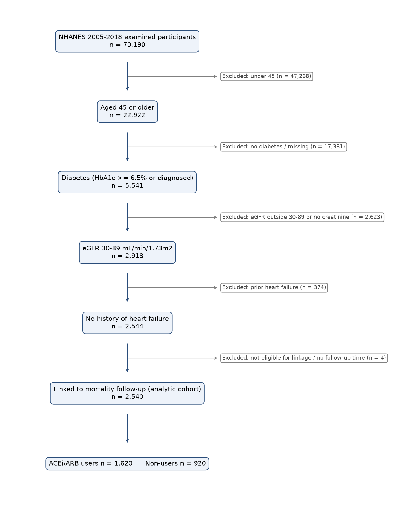
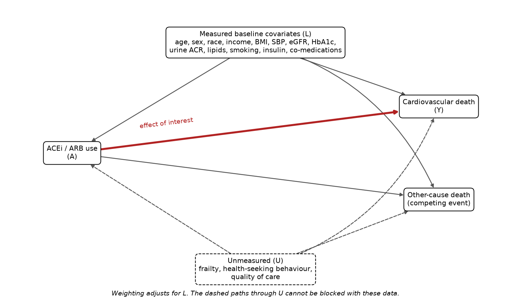

# Target trial emulation: ACEi/ARB use and cardiovascular death in type 2 diabetes with CKD (NHANES 2005-2018)

[](https://github.com/rushadnihal/causal-survival-analysis/actions/workflows/ci.yml)

An installable Python project that emulates a hypothetical randomized trial with observational NHANES data,
using inverse-probability weighting, a parametric g-formula and competing-risks survival estimators.
The headline result is a carefully qualified **null / inconclusive** finding on cardiovascular death, plus a diagnosis of why:
residual healthy-user bias that adjustment for measured covariates cannot fully remove, and a sample too small to detect modest effects.

> This is a methods project. It does not support clinical conclusions about ACEi/ARB therapy.



## Target trial protocol vs. what was actually emulated

| Component | Target trial (hypothetical RCT) | Observational emulation (as implemented) |
|---|---|---|
| 1. Eligibility | Adults aged 45+ with type 2 diabetes and mild-to-moderate CKD (eGFR 30-89), no prior heart failure | Same thresholds in NHANES 2005-2018 MEC participants linked to mortality. Diabetes = HbA1c >= 6.5% **or** doctor-diagnosed; eGFR by CKD-EPI 2021 (race-free) from serum creatinine; heart failure from self-report (MCQ160B). No type 1 exclusion was applied. |
| 2. Treatment strategies | Initiate an ACEi/ARB vs. no ACEi/ARB | **Currently taking** an ACEi/ARB at the home interview (generic name ending -pril / -sartan) vs. not. A true new-user design was not feasible (see below). |
| 3. Assignment | Random, 1:1 | Conditional exchangeability given measured baseline covariates: demographics, income, BMI, SBP, eGFR, HbA1c, urine ACR, lipids, smoking, hypertension history, insulin, and six co-medication classes |
| 4. Follow-up | From randomization to death, loss, or 10 years | From the MEC exam to death or end of 2019 (NCHS 2019 public-use linked mortality), up to ~15 years; 60- and 120-month horizons |
| 5. Outcome | Cardiovascular death; competing event: non-cardiovascular death | CVD death = underlying cause category 1 (heart disease) or 5 (cerebrovascular); competing = all other deaths |
| 6. Estimand | ITT and per-protocol effect on cumulative incidence | Observational analogue of ITT: risk difference in cumulative incidence of CVD death at 60 and 120 months, and restricted mean time. Per-protocol / time-varying estimands are **not identifiable** (single baseline measurement). |
| 7. Analysis | Aalen-Johansen cumulative incidence | Stabilized IPTW (truncated at 1st/99th percentiles) with a hand-implemented weighted Aalen-Johansen estimator; parametric g-formula; bootstrap CIs (propensity model refit each replicate); Rao-Wu survey-design bootstrap; negative control outcome; sensitivity analyses; simulation with known truth |

### Why not a new-user, SGLT2i design?
NHANES records current medication use at one interview, not initiation dates. In the 2013-14 cycle only 5 SGLT2 inhibitor
records exist in the whole cycle; ACEi/ARB users with <= 180 days of use numbered 9 among 376 eligible people; and
most calcium-channel-blocker users (74 of 100) were also on an ACEi/ARB. The design was therefore reframed as a
prevalent-user contrast with explicit bias diagnostics.



## Data (all public)
- NHANES 2005-2018 (cycles D-J): DEMO, GHB, BIOPRO, DIQ, MCQ, RXQ_RX, BMX, SMQ, ALB_CR, HDL, TCHOL, BPQ, BPX (BPXO for 2017-18)
- NCHS Public-use Linked Mortality Files, 2019 release (fixed-width; the layout is pinned by `tests/test_mortality_layout.py`)

Analytic cohort: **2,540** people (920 untreated, 1,620 ACEi/ARB), 222 CVD deaths and 446 other deaths (167 from cancer, lung disease or accidents).

## Results
Risk difference = ACEi/ARB minus untreated, percentage points, 95% bootstrap CI.

**Covariate balance.** After stabilized weighting the largest absolute standardized mean difference fell from 0.788 (hypertension history) to 0.051; no covariate exceeds 0.10 (`figures/love_plot.png`, `figures/ps_overlap.png`).

| Method | CVD death @60 mo | CVD death @120 mo | Other-cause death @60 mo | Other-cause death @120 mo |
|---|---|---|---|---|
| IPTW (B = 500) | +0.74 (-1.42, +2.74) | -2.31 (-6.66, +1.94) | -3.32 (-7.12, +0.01) | -1.77 (-7.98, +3.79) |
| IPTW x survey weights, Rao-Wu bootstrap (B = 500) | +1.02 (-1.62, +3.32) | -1.14 (-5.78, +3.52) | -6.23 (-12.56, -0.41) | -4.36 (-11.59, +1.72) |
| Parametric g-formula (B = 200) | +0.20 (-1.66, +1.59) | -0.79 (-4.18, +2.81) | -1.00 (-3.82, +1.45) | -1.05 (-5.74, +2.80) |

**Restricted mean time (IPTW, months, ACEi/ARB minus untreated).** Months alive: +0.52 (-0.61, +1.79) at 60 months and +2.27 (-1.31, +6.05) at 120 months.
Of the 2.27 months at 120 months, about 0.46 is fewer months lost to CVD death (-0.46; CI -3.04 to +1.51) and about 1.81 is fewer months lost to other causes (-1.81; CI -5.31 to +1.24): most of the apparent gain comes from causes the drug should not affect.

**Negative control** (deaths from cancer, chronic lung disease and accidents, n = 167; IPTW): -1.59 (-3.58, +0.22) at 60 months and -1.08 (-4.54, +2.22) at 120 months.

**Sensitivity analyses** (IPTW, B = 200): no truncation, 5/95 truncation, overlap weights, trimming propensity scores outside 0.05-0.95, and dropping the 2005-06 cycle (creatinine recalibration concern).
CVD estimates stayed between +0.12 and +1.26 at 60 months and between -1.83 and -2.77 at 120 months, with every interval including zero.
The other-cause estimate stayed protective (-2.66 to -5.04 at 60 months); dropping 2005-06 made it larger, not smaller, so the bias is not a lab artifact.

**Restricting treated people to <= 2 years on the drug** (477 treated, medication-adjusted model): CVD death -0.15 (-3.18, +2.58) at 60 months; other-cause death -3.28 (-7.36, +0.90) at 60 months and +2.20 (-4.79, +8.63) at 120 months. The other-cause estimate did not move toward zero (it is -3.32 in the full cohort), so duration of use does not explain the bias. Unmeasured confounding such as frailty or quality of care is the more likely source, but these data cannot confirm that.

### Interpretation
- No effect on cardiovascular death can be detected in either direction, under any of the estimators or sensitivity choices.
- Treated people look protected even against causes of death the drug should not affect (negative control, other-cause death, RMST decomposition). This is the signature of healthy-user bias (prevalent-user bias is also possible, but restricting to recent users did not reduce it); treated people take far more of every drug class (statins 65% vs 42%, diuretics 47% vs 21%). Effects smaller than about 1-2 points cannot be distinguished from this bias.
- IPTW and the g-formula agree on CVD death. They disagree on how much bias remains in other-cause death (IPTW larger), which is reported as is.

### Validation by simulation (`scripts/simulate.py`)
Real covariates and follow-up, simulated treatment and death with a known truth (CVD hazard ratio 0.8, no effect on other deaths).

| | Naive bias (points) | IPTW bias (points) |
|---|---|---|
| No built-in confounding | within +/-0.15 | within +0.21 |
| Built-in healthy-user confounding | -2.8 to -8.0 | -0.1 to -0.6 |

IPTW removes about 90% of confounding that runs through measured covariates, so the residual bias in the real data most likely
comes from **unmeasured** factors. Even without confounding, the root-mean-square error is 1.3-2.8 points: this sample cannot
reliably detect a 20% reduction in CVD death hazard.

## Limitations
- Prevalent-user design; current use is recorded at one time point and says nothing about adherence or initiation.
- Drug classes are identified by generic-name patterns; type 1 diabetes was not excluded.
- The Rao-Wu survey bootstrap uses only the PSUs present in the analytic cohort (a domain analysis would retain the full design); the other bootstraps resample individuals and ignore the sampling design.
- Urine ACR (27% missing), income, BP and BMI were median-imputed with missingness flags; no multiple imputation yet.
- Serum creatinine in 2005-06 may need recalibration (the sensitivity analysis shows conclusions do not depend on that cycle).
- Public-use mortality files are lightly perturbed by NCHS to limit disclosure.
- The simulation uses a correctly specified propensity model; real-data weighting will do no better. The g-formula assumes no treatment x covariate interactions.

## Repository layout
```
src/tte/            library: mortality parser, propensity design matrix, stabilized weights,
                    weighted Aalen-Johansen, restricted means
scripts/            runnable pipeline steps (run from the project root)
tests/              unit tests (weighted AJ vs Kaplan-Meier, restricted means, weight stabilization, mortality layout)
figures/            cohort flowchart, causal DAG, propensity overlap, Love plot
data/raw, data/processed   downloaded files and analytic cohorts (git-ignored)
```

## Reproduce
```bash
python3 -m venv .venv && source .venv/bin/activate
python3 -m pip install -e ".[dev]"
python3 -m pytest

python3 scripts/download_nhanes.py
python3 scripts/download_covariates.py
python3 scripts/download_mortality.py

python3 scripts/build_cohort.py        # eligibility, treatment flag, mortality outcome
python3 scripts/build_covariates.py    # confounders
python3 scripts/add_meds.py            # co-medication flags
python3 scripts/weights.py             # propensity model, stabilized weights, balance, Love plot / overlap
python3 scripts/survival_report.py     # weighted cumulative incidence + validation checks
python3 scripts/bootstrap.py           # IPTW bootstrap CIs (optional arg: max treated duration in days)
python3 scripts/nc_bootstrap.py        # negative control outcome
python3 scripts/survey_bootstrap.py    # survey-design (Rao-Wu) bootstrap
python3 scripts/sensitivity.py         # truncation / overlap / trimming / drop 2005-06
python3 scripts/rmst_bootstrap.py      # restricted mean times
python3 scripts/gformula.py 200        # parametric g-formula
python3 scripts/simulate.py -0.5       # simulation with built-in confounding
python3 scripts/figures.py             # cohort flowchart
python3 scripts/draw_dag.py            # causal DAG
```

## Not done
Multiple imputation; a time-varying marginal structural model / clone-censor-weight module (would need a dataset with repeated
treatment measurements, e.g. the Framingham teaching data); an interactive dashboard.

<!-- extra-sections -->
## Additional analyses

### Multiple imputation (`scripts/multiple_imputation.py`)
Urine ACR is 27% missing (income 10%, SBP 5%, BMI 2.5%). The main analysis fills missing values with the
median plus missing flags. As a check, values were imputed 10 times (chained regression using treatment,
outcomes and follow-up time as auxiliary variables), IPTW was rerun in each, and results were pooled with
Rubin's rules (100 bootstrap replicates per imputation).

| Risk difference, ACEi/ARB minus untreated (points) | Multiple imputation | Median-fill |
|---|---|---|
| CVD death @60 mo | +0.69 (-1.64, +3.03) | +0.74 (-1.42, +2.74) |
| Other death @60 mo | -3.89 (-7.56, -0.23) | -3.32 (-7.12, +0.01) |
| CVD death @120 mo | -2.85 (-7.24, +1.54) | -2.31 (-6.66, +1.94) |
| Other death @120 mo | -2.27 (-7.77, +3.22) | -1.77 (-7.98, +3.79) |

Missing-data handling does not change the conclusions. The apparent protection against other-cause death is
the same residual healthy-user bias seen elsewhere, not a drug effect.

### Time-varying treatment-confounder feedback (`scripts/simulate_tv.py`)
Simulation with a known truth: sicker people are more likely to be treated, and treatment lowers later
severity. True risk difference at 6 intervals: -12.76 points (5,000 people, 200 replications).

| Method | Mean | Bias | RMSE |
|---|---|---|---|
| Unadjusted | -0.63 | +12.13 | 12.26 |
| Adjusted for current severity | -5.66 | +7.10 | 7.38 |
| IPTW marginal structural model | -10.45 | +2.31 | 3.29 |

Conventional adjustment fails under feedback; weighting recovers most of the effect. This supports the
weighting machinery but does not remove the single-baseline limitation of NHANES.

### Dashboard
```
python3 -m pip install streamlit
python3 -m streamlit run scripts/dashboard.py
```
Four tabs (Summary, Effect estimates, Bias diagnostics, Simulations) read `data/results/*.csv` and `figures/`.

## Licence

MIT (see `LICENSE`).
